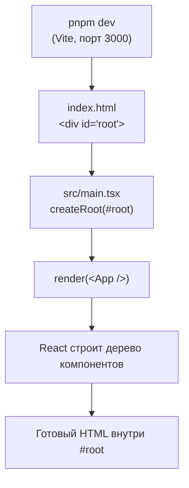
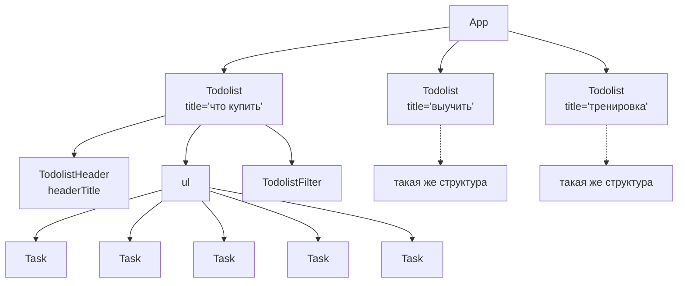
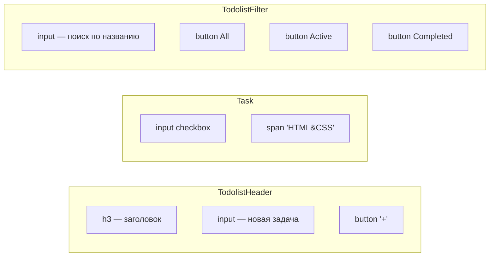
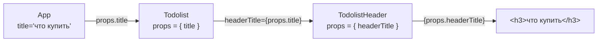
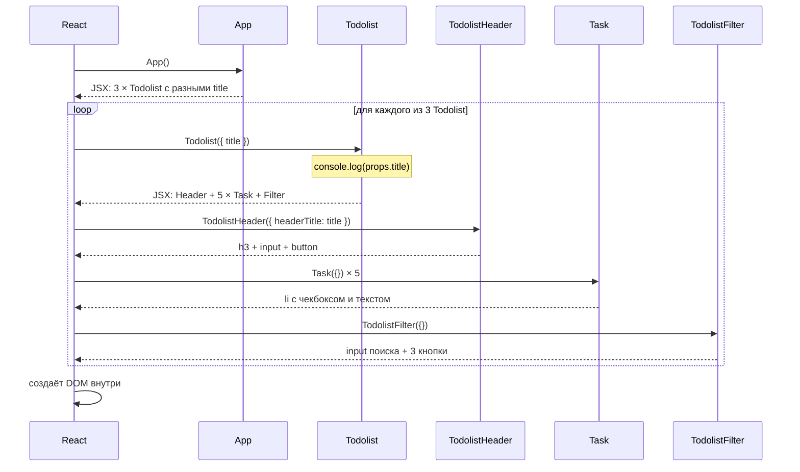
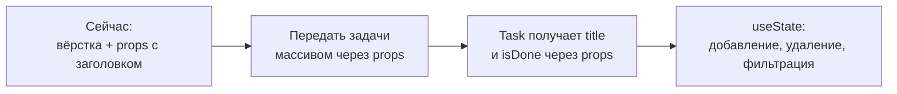

# Как устроено приложение Todolist

Учебное приложение на **React 19 + TypeScript + Vite**. Сейчас это только
вёрстка: интерфейс рисуется, но кнопки, чекбоксы и поля ввода пока ничего
не делают. Единственные «живые» данные — заголовки тудулистов, которые
передаются через **props**.

## 1. Запуск: от `index.html` до экрана



1. Vite отдаёт браузеру `index.html`. В нём есть пустой `<div id="root">` и
   подключается скрипт `src/main.tsx`.
2. `main.tsx` находит `#root` и говорит React: «нарисуй здесь `<App />`».
3. React вызывает функцию `App`, она возвращает JSX с другими компонентами,
   React вызывает и их, и так до самого низа дерева.
4. Результат превращается в настоящие DOM-элементы на странице.

## 2. Декомпозиция: из каких компонентов состоит приложение

Каждый компонент лежит в своём файле в `src/`:

| Файл | Компонент | За что отвечает |
|---|---|---|
| `main.tsx` | — | Точка входа, монтирует `App` в `#root` |
| `App.tsx` | `App` | Корень: рисует три тудулиста с разными заголовками |
| `Todolist.tsx` | `Todolist` | Один список дел: шапка + задачи + фильтр |
| `TodolistHeader.tsx` | `TodolistHeader` | Заголовок, поле ввода и кнопка `+` |
| `Task.tsx` | `Task` | Одна задача: чекбокс и текст |
| `TodolistFilter.tsx` | `TodolistFilter` | Поиск по названию и кнопки All / Active / Completed |

### Дерево компонентов



`Todolist` — это **шаблон**. `App` использует его три раза, и React создаёт
три независимых экземпляра. Внутри у них одинаковая структура, отличаются
они только тем, что пришло в props.

### Что внутри каждого компонента (вёрстка)



## 3. Props: как данные «спускаются» сверху вниз

**Props** (properties) — это аргументы компонента. Родитель пишет их в JSX
как атрибуты, а React собирает их в объект и передаёт в функцию дочернего
компонента первым параметром.

```tsx
// App.tsx — родитель передаёт
<Todolist title={'что купить'} />

// React под капотом делает примерно так:
Todolist({ title: 'что купить' })
```

### Путь заголовка от `App` до `<h3>`



Обрати внимание: **имя prop'а может меняться** при передаче дальше.
`Todolist` получает значение под именем `title`, а своему ребёнку отдаёт его
уже под именем `headerTitle`. Значение то же, имя выбирает тот, кто передаёт.

### Что происходит при рендере (по шагам)



### Правила props, которые важно запомнить

- **Однонаправленный поток данных.** Props идут только сверху вниз:
  родитель → ребёнок. Ребёнок не может изменить props родителя.
- **Props только для чтения.** Внутри компонента нельзя писать
  `props.title = '...'`.
- **Компонент без props тоже получает объект**, просто пустой: `Task` и
  `TodolistFilter` сейчас ничего не получают, поэтому у всех пяти задач
  одинаковый текст `HTML&CSS`.

## 4. Текущее состояние кода: на что обратить внимание

Приложение отображается в браузере, потому что Vite не проверяет типы при
разработке. Но `tsc` (и команда `pnpm build`) найдёт две ошибки:

1. **`Todolist.tsx`: `props: number`.** Тип указан неверно: props — это
   объект, а не число. Поэтому TypeScript ругается на `props.title`. Нужен
   тип вида:

   ```tsx
   type TodolistProps = { title: string }
   export function Todolist(props: TodolistProps) { ... }
   ```

2. **`TodolistHeader.tsx`: `props` без типа.** Параметр неявно получает тип
   `any`, а в проекте включён строгий режим. Нужен тип
   `{ headerTitle: string }`. Это и есть тот «контракт / сигнатура» из
   комментария в файле: тип props описывает, что компонент ожидает получить.

Ещё одна мелочь, которая не ломает сборку:

3. **`App.tsx`: лишний импорт** `import { jsx as _jsx } from "react/jsx-runtime"`.
   Он не используется: JSX и так компилируется автоматически, поэтому строку
   можно удалить.

## 5. Куда это развивается дальше



Следующий логичный шаг — передавать в `Todolist` массив задач, а в `Task` —
название и статус каждой задачи. Тогда пять одинаковых `HTML&CSS`
превратятся в настоящий список, а фильтр и поиск получат данные для работы.
