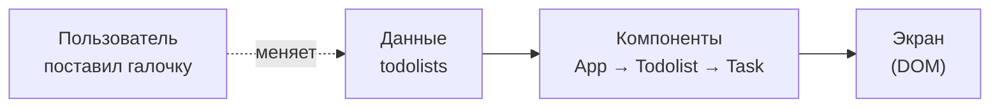

# Зачем вообще нужен React

Браузер и так умеет показывать HTML и выполнять JavaScript. Тудулист можно
написать на чистом JS — без React. Так зачем нам ещё одна библиотека?

Короткий ответ: **React снимает с нас самую неблагодарную работу —
синхронизацию данных и того, что нарисовано на экране.**

## 1. Главная проблема любого интерфейса

В любом приложении есть две вещи:

- **данные** — массив `todolists` в `App.tsx`: названия списков, задачи,
  флажки `isDone`;
- **картинка на экране** — DOM: заголовки `h3`, чекбоксы, счётчик
  `( 3 tasks )`.

Пока данные не меняются, всё просто: один раз нарисовали — и готово.
Но интерфейс живой: пользователь ставит галочку, добавляет задачу, жмёт
фильтр `Active`. Каждый раз данные меняются, и **картинка должна поменяться
вслед за ними — везде, где эти данные используются.**

## 2. Как это выглядит без React

На чистом JS мы сами командуем браузером: «найди элемент», «создай `li`»,
«поменяй текст». Это называется **императивный** подход — мы описываем
*шаги*, как прийти к нужному виду.

```js
// добавили задачу — надо не забыть всё, что от неё зависит
function addTask(todolistId, title) {
    const todolist = todolists.find(t => t.id === todolistId)
    todolist.tasks.push({id: Date.now(), title, isDone: false})

    // 1. нарисовать новую <li>
    const ul = document.querySelector(`#todolist-${todolistId} ul`)
    const li = document.createElement('li')
    li.innerHTML = `<input type="checkbox"> <span>${title}</span>`
    ul.append(li)

    // 2. обновить счётчик в заголовке
    const h3 = document.querySelector(`#todolist-${todolistId} h3`)
    h3.textContent = `${todolist.title} ( ${todolist.tasks.length} tasks )`

    // 3. а если включён фильтр «Completed»? новую задачу показывать нельзя...
    // 4. а если стоит поиск по названию? ...
}
```

Что здесь плохо:

- **Каждое изменение данных = ручное обновление DOM.** Добавили задачу —
  обновили список *и* счётчик. Удалили — снова и то, и другое. Отметили
  галочку — проверили фильтр.
- **Легко забыть одно из мест.** Забыли обновить счётчик — на экране
  `3 tasks`, а задач уже четыре. Данные и картинка «разъехались» — это
  самый частый класс багов в интерфейсах.
- **Код растёт как снежный ком.** Каждая новая фича (фильтр, поиск,
  удаление) должна знать про все остальные и аккуратно обновлять их кусочки
  DOM.

## 3. Как это выглядит с React

С React мы **не говорим, как менять экран. Мы описываем, как экран должен
выглядеть при текущих данных.** Это **декларативный** подход.

Смотрим на наш `TodolistHeader.tsx`:

```tsx
export function TodolistHeader(props: TodolistHeaderProps) {
    return <h3>{props.headerTitle} ( {props.tasksCount} tasks )</h3>
}
```

Тут нет ни одного `querySelector` и ни одного «обнови текст». Есть только
правило: *«заголовок — это название и количество задач»*. Когда задач
станет четыре, React сам перерисует заголовок, и счётчик **не может**
разъехаться с данными — он всегда вычисляется из них.

Эту идею записывают одной формулой:

```
UI = f(data)
```

Интерфейс — это функция от данных. Компонент — это и есть такая функция:
получил данные (props) — вернул JSX.



Мы отвечаем только за левую часть: **поменять данные**. Как превратить
новые данные в правильный DOM — забота React. Он сам сравнит, что было
и что стало, и обновит в браузере только то, что реально изменилось.
Увидеть это можно уже сейчас: в `Todolist.tsx` стоит
`console.log('rerender todolist: ...')` — это React вызывает наш
компонент заново, чтобы узнать, как должен выглядеть экран.

## 4. Бонус: компоненты

Второе, что даёт React, — возможность разбить интерфейс на **компоненты**:
маленькие независимые кусочки со своим контрактом (props).

В нашем проекте:

- `Task` знает только про одну задачу и ничего — про список;
- `TodolistHeader` получает только `headerTitle` и `tasksCount`, а не весь
  тудулист — ему больше ничего не нужно;
- `Todolist` собирает шапку, задачи и фильтр, а `App` просто рисует три
  тудулиста по массиву данных.

Один и тот же `Todolist` мы используем три раза — для «что купить»,
«выучить» и «тренировка». На чистом JS для этого пришлось бы писать
функции-шаблоны и вручную следить, какой кусок DOM к какому списку
относится. В React это просто `todolists.map(t => <Todolist todolist={t} />)`.

## Итого

| Без React | С React |
|---|---|
| Описываем **шаги**: найди, создай, поменяй | Описываем **результат**: как выглядит экран при этих данных |
| Сами синхронизируем данные и DOM | React синхронизирует сам, мы только меняем данные |
| Легко забыть обновить одно из мест | Картинка всегда вычисляется из данных |
| Интерфейс — один большой скрипт | Интерфейс — дерево маленьких компонентов |

**React нужен, чтобы мы думали о данных и о том, как они выглядят, а не о
том, как вручную перекрашивать страницу после каждого клика.**
